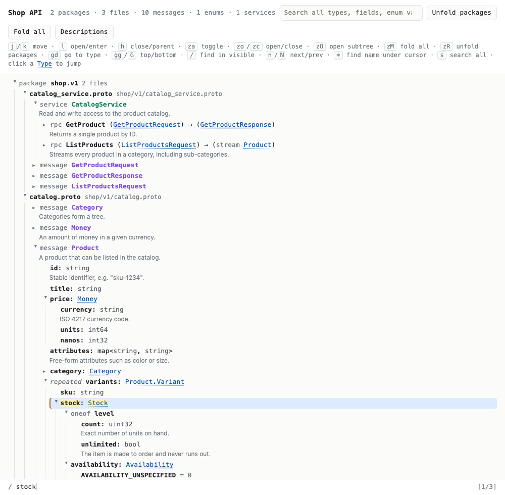

# proto-tree

Render a set of `.proto` files as a single, self-contained HTML page that you can
browse as a collapsible tree, with vim-style keyboard navigation.



- **Tree:** package → file → service / message / enum.
- **Drill down through types:** a field whose type is a message or enum expands
  into that type's fields, as deep as you like. Fields that refer back to a type
  already open above them are tagged `recursive`.
- **RPCs:** each method expands into its request and response types; streaming
  is shown.
- **Readable fields:** oneofs are grouped, maps render as `map<K, V>`, and
  `optional` / `repeated` / `deprecated` are shown. Comments from the `.proto`
  files appear under each row.
- **Jump to definition:** click any blue type name (or press `gd`).
- **Two kinds of search:** a global search over all types, fields, enum values
  and RPCs, and a vim-style `/` find that only matches what is currently
  expanded on screen.
- **One offline file:** the schema data is embedded in the page. There are no
  network requests and nothing to serve; open it straight from disk.

It's a thin layer over [protoc-gen-doc](https://github.com/pseudomuto/protoc-gen-doc):
`proto-tree` runs `protoc` with protoc-gen-doc's JSON output, then inlines that
JSON into `template.html`.

## Requirements

- `bash`, `awk`, `find` (any Linux or macOS)
- [`protoc`](https://protobuf.dev/installation/)
- `protoc-gen-doc` (see below)
- A modern browser (tested in Chrome)

### Installing protoc-gen-doc

For proto2 / proto3 files, the released version is fine:

```sh
go install github.com/pseudomuto/protoc-gen-doc/cmd/protoc-gen-doc@latest
```

**If any of your files use protobuf editions** (`edition = "2023";` or later),
the released version (v1.5.1) and current `master` both refuse them with
`is an editions file, but code generator protoc-gen-doc hasn't been updated to
support editions yet`. Until
[pseudomuto/protoc-gen-doc#563](https://github.com/pseudomuto/protoc-gen-doc/pull/563)
is merged, build that PR instead:

```sh
git clone https://github.com/pseudomuto/protoc-gen-doc.git
cd protoc-gen-doc
git fetch origin pull/563/head:editions
git checkout editions
go build -o "$(go env GOPATH)/bin/protoc-gen-doc" ./cmd/protoc-gen-doc
```

`proto-tree` uses `protoc-gen-doc` from your `PATH`, or the binary named by
`PROTOC_GEN_DOC`.

## Quick start

```sh
git clone https://github.com/zhiyanfoo/proto-tree.git
cd proto-tree
./proto-tree -t "Shop API" -o /tmp/shop.html example/proto3 example/editions
open /tmp/shop.html        # macOS; use xdg-open on Linux
```

The example has two proto roots. `example/editions` holds a file that uses
editions and imports from `example/proto3`. With the released protoc-gen-doc,
leave it out: `./proto-tree -o /tmp/shop.html example/proto3`.

## Usage

```text
proto-tree [options] <proto_root>...
proto-tree [options] --json <protoc-gen-doc.json>

  -I, --proto_path DIR   Extra import path for dependencies (repeatable).
  -o, --out FILE         Output HTML file (default: proto-tree.html).
  -t, --title TITLE      Page title (default: "Proto tree").
      --json FILE        Skip protoc; render JSON already produced by
                         protoc-gen-doc (--doc_opt=json,<name>.json).
```

### Proto roots and import paths

A **proto root** is a directory your imports are relative to, the same thing
you would pass to `protoc -I`. Every `.proto` file under each root is documented,
and each root is also added as an import path.

Anything your files import from outside the roots (third-party protos,
`buf/validate/validate.proto`, `google/api/annotations.proto`, …) needs an `-I`
pointing at a directory that contains it. Those dependencies are used to compile
but are **not** documented; their types show as plain names that don't expand.
To document them too, pass their directory as a root instead of with `-I`.

```sh
# Document everything under proto/, resolving imports from two vendored trees.
./proto-tree -t "My API" -o api.html \
  -I third_party/googleapis \
  -I third_party/protovalidate/proto/protovalidate \
  proto
```

Well-known types (`google/protobuf/*.proto`) are usually found by `protoc` on
its own. If they aren't, add `-I "$(brew --prefix)/include"` or wherever your
protoc install keeps them.

### Using buf

If your project builds with [buf](https://buf.build), let buf resolve the
imports and run protoc-gen-doc, then hand the JSON to `proto-tree`:

```yaml
# buf.gen.yaml
version: v2
plugins:
  - local: protoc-gen-doc
    out: gen/doc
    opt: json,protos.json
```

```sh
buf generate
./proto-tree --json gen/doc/protos.json -t "My API" -o api.html
```

The same `--json` flag works with JSON from any other protoc-gen-doc setup.

## Keyboard

Click a row to put the cursor on it, or start pressing `j`.

| Key | Action |
| --- | --- |
| `j` / `k` (or `↓` / `↑`) | Move down / up |
| `l` (or `→`) | Open the node; if it's already open, move to its first child |
| `h` (or `←`) | Close the node; if it's already closed, move to its parent |
| `Enter`, `Space`, `o`, `za` | Toggle the node |
| `zo` / `zc` | Open / close |
| `zO` | Open the subtree, 3 levels deep, without following recursive types |
| `zM` | Fold everything |
| `zR` | Unfold all packages and files |
| `gd` | Go to the definition of the type on the current row |
| `gg` / `G` | First / last row |
| `/` | Find in **visible** rows. Matches highlight as you type; `Enter` accepts, `Esc` returns to where you started |
| `n` / `N` | Next / previous match, wrapping around |
| `*` | Find the field or type name on the current row |
| `Esc` | Clear find highlights (like `:noh`); press again to clear the global search |
| `s` | Focus the global search box |

The `/` find is smartcase: it is case-insensitive unless the pattern contains an
uppercase letter. It searches rows that are currently shown, which includes
descriptions while they're turned on. Content inside folded or never-opened
nodes is skipped, and `n` / `N` re-scan what is visible each time you press them.

The **Descriptions** button hides or shows the comments; the choice is remembered
per browser.

If `j` / `k` seem to do nothing, check for a vim-keys browser extension such as
Vimium or Vimari: they take those keys before the page sees them. Exclude
`file://` pages (or the path of your generated file) in the extension's settings.

## Limitations

- Only what protoc-gen-doc extracts is shown. In particular
  [protovalidate](https://github.com/bufbuild/protovalidate) (`buf.validate`)
  rules and most custom options are not displayed.
- Types from imported files that aren't under a proto root don't expand (see
  [Proto roots and import paths](#proto-roots-and-import-paths)).
- The whole schema is embedded in the page. Thousands of messages are fine
  because nodes are only built when you open them, but the HTML file grows with
  the size of the schema (roughly the size of protoc-gen-doc's JSON).

## License

[MIT](LICENSE)
